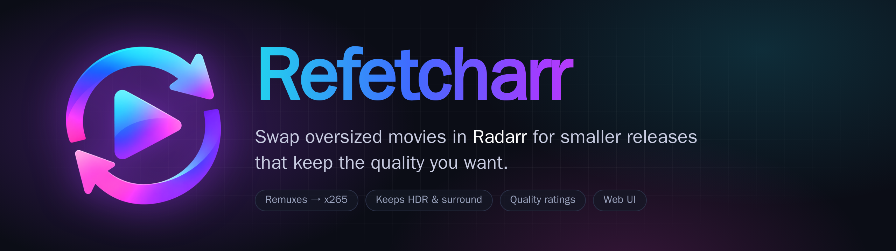
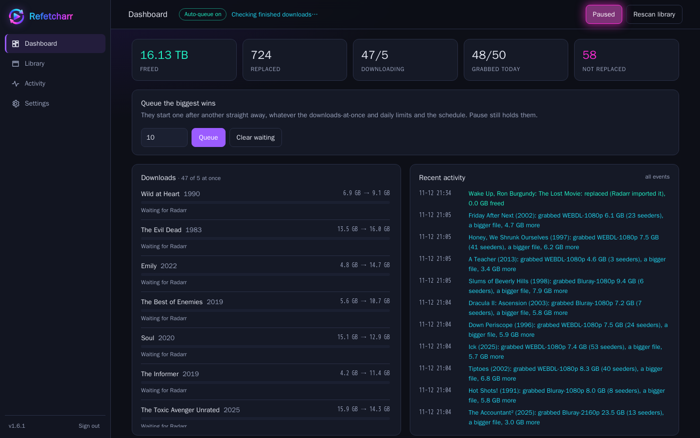
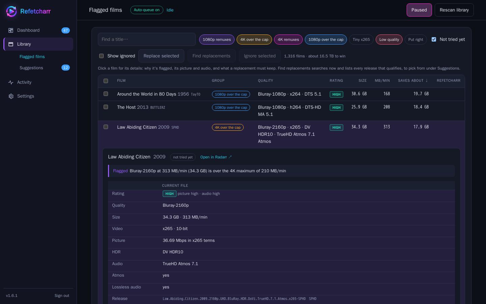
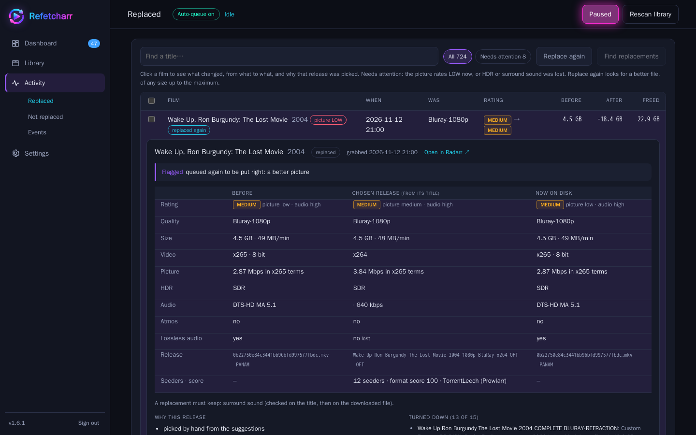
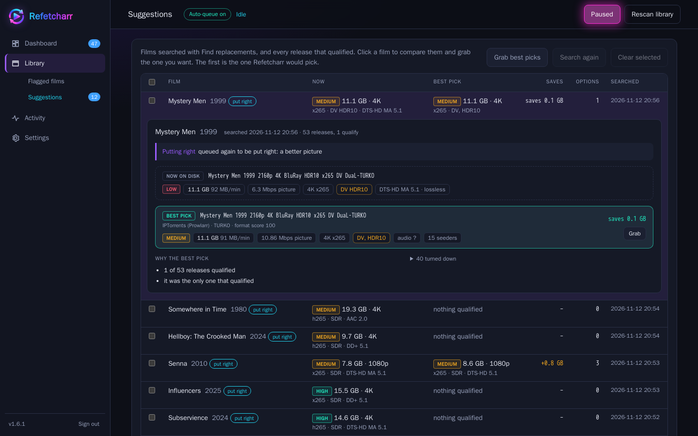
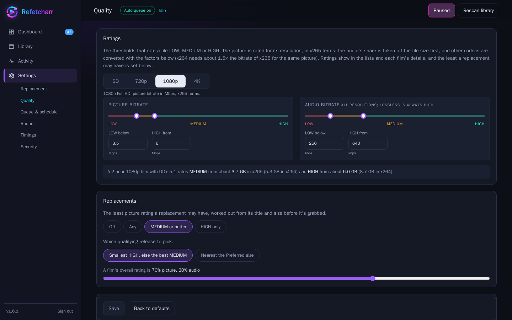

<p align="center"></p>

<p align="center">
  <a href="https://github.com/Jarsky/refetcharr/actions/workflows/ci.yml"></a>
  <a href="https://github.com/Jarsky/refetcharr/releases"></a>
  <a href="https://github.com/Jarsky/refetcharr/pkgs/container/refetcharr"></a>
  
  
  <a href="LICENSE"></a>
</p>

Refetcharr finds the films in your Radarr library that take far more space than they need (1080p remuxes, 4K remuxes,
oversized 4K encodes) and swaps each one for a smaller release that keeps the quality you want. It doesn't transcode
anything: it searches your indexers through Radarr, picks the best-sized release, downloads it, checks the file, and
replaces the old one.

On one 4,900-film library it has freed **16 TB** so far.

<p align="center"></p>

## Features

- **Finds the oversized films**: 1080p and 4K remuxes, and 1080p or 4K files over a size you set (MB per minute, so long
  films get more room). Optionally, files whose picture rates LOW, or tiny x265 encodes that need a bigger file.
- **Picks the best release**: the smallest one whose picture rates **HIGH** for its resolution, or the best MEDIUM when
  none does. Your preferred codecs (x265 first, by default) and Radarr's custom-format scores count too.
- **Keeps what matters**: HDR and Dolby Vision (with an HDR10 base), surround sound, Atmos, English audio, and optionally
  lossless audio. Each is checked on the release title before grabbing, then on the downloaded file before anything
  is replaced. A file that fails stays in your download client; the original stays.
- **Ratings out of 5**: every file and release is rated for its picture (bitrate for its resolution, in x265 terms) and
  its audio, weighted into one rating that also picks releases: LOW under 2.0, MEDIUM to 3.5, HIGH from 3.5. A score
  card shows each part against what HIGH needs.
- **Profiles**: Max savings, Balanced or Max quality set the sizes, keep rules and picture rating in one click; tune
  anything after and it's Custom.
- **Suggestions**: search now for chosen films and see every release that qualifies, side by side. Click a release to
  pick it; picks are remembered, so you can go film by film and grab them all at once.
- **Estimates**: tick films to see tiles for their size now, about how big they'd be after, the saving and the
  average rating, with any profile.
- **Covers or a list**, with filters (rating, resolution, HDR, Atmos; on Suggestions what's getting smaller or bigger,
  your picks) and sorting by saving, size, rating or rating gained.
- **Replace again**: films that came out LOW, or lost HDR or surround, are listed under *Needs attention* and can be put
  right with a better file.
- **Explains every decision**: open any film to see why it was flagged, the file before, the release chosen and the
  file now, why that release won, and every release turned down with the reason.
- **Runs by itself or by hand**: auto-queue within your limits (downloads at once, films per day, a schedule of days
  and hours), or queue films yourself. Pause any time.
- **Radarr setup checks** with one-click fixes, so Radarr doesn't "upgrade" replaced films straight back to remuxes, and
  a webhook so new files are checked as they arrive.
- **Web UI and terminal UI**, a sign-in like Sonarr's and Radarr's, an API key for scripts, and an event log.

| Flagged films | A film's details |
|---|---|
|  |  |
| **Suggestions** | **Quality settings** |
|  |  |

## Quick start

You need Radarr with qBittorrent as its download client, and Docker on the machine Radarr runs on.

```bash
git clone https://github.com/Jarsky/refetcharr.git && cd refetcharr
cp .env.example .env && chmod 600 .env
# edit .env: MEDIA_PATH (the folder Radarr sees as /data) and DOCKER_NETWORK (the network Radarr is on)
docker compose up -d --build
```

Open `http://<host>:8787`, create the sign-in, then:

1. **Settings → Radarr**: enter Radarr's address and API key (or set `RADARR_API_KEY` in `.env`), and press **Fix**
   on anything the setup checks flag. These stop Radarr undoing the work, and add the webhook.
2. **Library → Flagged films**: after the first scan (it starts by itself), look through what was flagged. Open a
   film to see why.
3. Replace a few by hand (**Replace selected**, or **Find replacements** to choose the release yourself), check the
   results under **Activity → Replaced**, then switch on **Auto-queue** when you're happy.

A prebuilt image is also published: use `image: ghcr.io/jarsky/refetcharr:latest` in `docker-compose.yml` instead of
`build: .`.

## How it decides

1. **Flag**: a scan (weekly, or when Radarr imports a file) groups every film: remuxes, 4K or 1080p over the
   Maximum size, and optionally Low quality and Tiny x265.
2. **Search**: Radarr searches your indexers for the film.
3. **Judge**: a release qualifies when it's at most 70% of the current file, at least the Minimum size, the same
   resolution or higher, has enough seeders, rates at least MEDIUM, and keeps HDR, surround, Atmos and English audio.
4. **Pick**: the highest resolution, then the best rating, then your codec order, then the **smallest HIGH**
   release (or the best MEDIUM), then format score and seeders.
5. **Check and import**: when the download finishes, ffprobe checks the file again. Radarr then imports it with an
   override (it won't replace a file with a smaller one of the same quality by itself), and the old file goes.

Every film is remembered, so nothing is downloaded twice. Films with no qualifying release are listed under
**Not replaced** and can be retried later.

## Settings

Everything is set in the web UI and saved in `config/settings.json`. The defaults suit most libraries.

| Page | What's there |
|---|---|
| **Replacement** | Which groups to go after; what to keep (HDR, surround, Atmos, lossless, English); release groups to leave alone or never download; file sizes (sliders like Radarr's quality sizes); preferred video and audio codecs; seeders |
| **Quality** | The LOW / MEDIUM / HIGH thresholds per resolution (SD, 720p, 1080p, 4K) and for audio; the least rating a replacement may have; how to pick (smallest HIGH, or nearest the preferred size); codec efficiency |
| **Queue & schedule** | Auto-queue, downloads at once, films per day, rescan interval, days and hours to search in |
| **Radarr** | The connection, Refetcharr's address for Radarr's webhook, and the setup checks with their fixes |
| **Timings** | How long to wait on Radarr and qBittorrent before deciding something |
| **Security** | The sign-in and the API key |

The default ratings, as picture bitrate in x265 terms:

| | LOW below | HIGH from | A 2-hour x265 film at HIGH |
|---|---|---|---|
| 1080p | 3.5 Mbps | 6 Mbps | about 6 GB |
| 4K | 9 Mbps | 15 Mbps | about 14 GB |

## Commands

The terminal UI and these commands run inside the container and use the API key by themselves.

```bash
docker exec -it refetcharr refetcharr             # the terminal UI
docker exec refetcharr refetcharr status          # the dashboard once
docker exec refetcharr refetcharr queue 20        # the next 20 biggest wins, now
docker exec refetcharr refetcharr queue --id 1234 # one film (Radarr movie id)
docker exec refetcharr refetcharr pause           # no new searches (running downloads still import)
docker exec refetcharr refetcharr retry           # try every film that wasn't replaced again
docker exec refetcharr refetcharr scan            # rescan the library
docker exec -it refetcharr refetcharr login set admin   # a new username and password if you're locked out
docker exec refetcharr refetcharr apikey          # the API key (X-Api-Key header); --new for a new one
```

## Good to know

- Downloads are torrents from Radarr's indexers. Keep them seeding after import if your trackers need it.
- The media folder is mounted read-only at the same path Radarr uses, so the file checks see downloads where Radarr
  says they are.
- Plex, Jellyfin and Emby pick up each swap through Radarr's own Connect settings (the setup checks warn if none is
  set up).
- Reports of the whole library and the flagged films (`movies.csv`, `oversized.csv`) are written to `config/reports/`
  after every scan.
- TV (Sonarr) support is on the way.

## Development

```bash
pip install -e ".[dev]"            # ffmpeg is needed for the file-check tests
ruff check refetcharr tests && pytest -q
REFETCHARR_DATA=./config RADARR_API_KEY=... refetcharr serve
```

See [CHANGELOG.md](CHANGELOG.md) for what changed in each version.

## License

[MIT](LICENSE)
